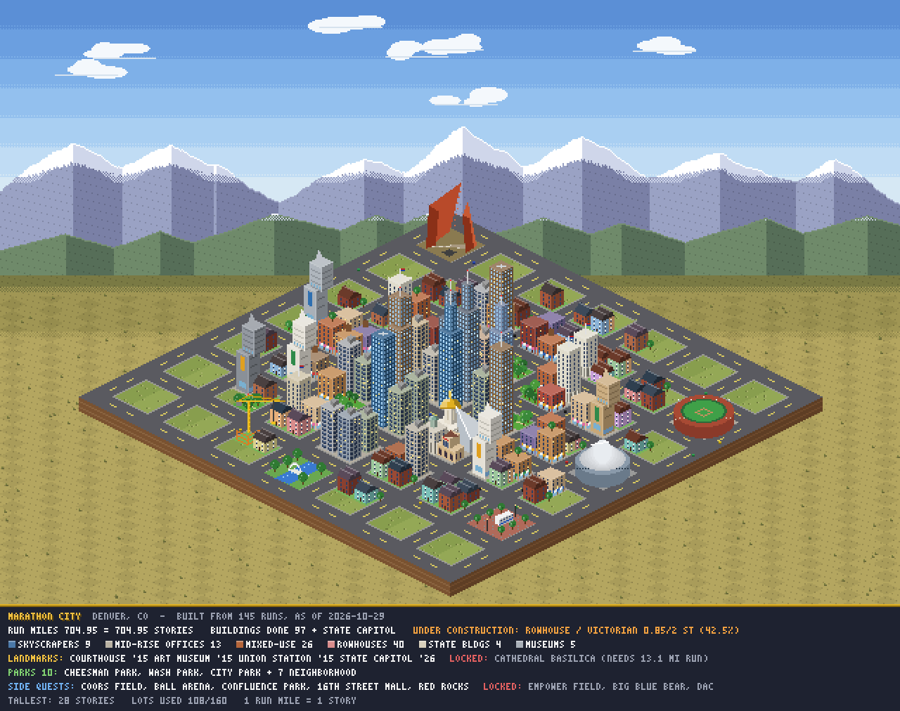
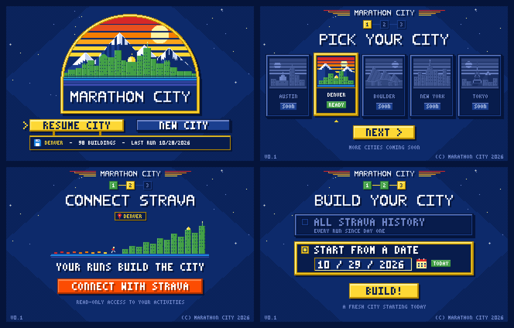
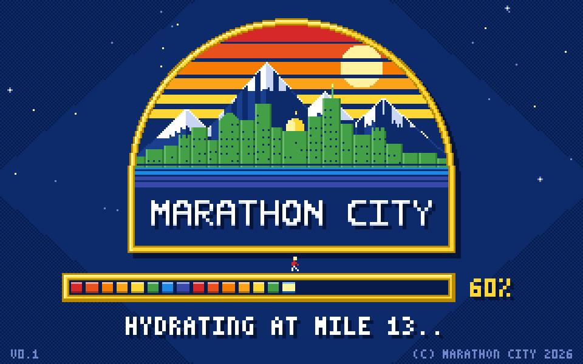
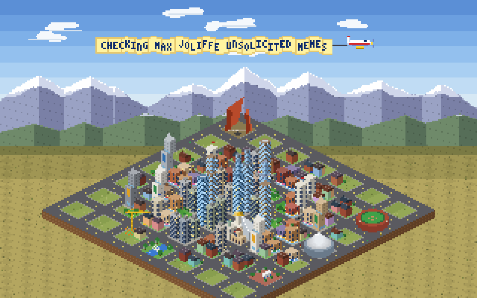

# Marathon City

Marathon City turns the owner's Strava runs into a growing pixel-art city. The look is isometric, in the spirit of SimCity 2000, and the theme is Denver. The app is planned as a plain-JavaScript Next.js site, hosted on Vercel, and laid out for a phone.

The Next.js app shell lives at the repo root. The home page is a placeholder; the real screens come later. The rules, the deterministic replay, and the pixel stills stay in [`prototype/`](prototype/) as reference. New to the code? Read [docs/NOTES.md](docs/NOTES.md) for the folder map, how a request flows, and how to add a page.



## Run locally

Node.js 20.9 or newer. That is the minimum for Next.js 16.

```bash
cp .env.example .env.local
npm install
npm run dev
```

Open [http://localhost:3000](http://localhost:3000).

`.env.local` is gitignored. Fill in `STRAVA_CLIENT_ID`, `STRAVA_CLIENT_SECRET`, `STRAVA_REDIRECT_URI`, and `DATABASE_URL` there. The names have no `NEXT_PUBLIC_` prefix, so Next.js keeps them in server code and out of the browser bundle. Restart the dev server after changing them. The Strava route and the database will read them later.

`@pixi/react` is not installed. Release 8.0.5 is built on `react-reconciler` 0.31, which targets React 19.0, and this app uses React 19.3. `pixi.js` itself is installed for the city canvas. Details are in [docs/NOTES.md](docs/NOTES.md).

## How a run becomes a building

One mile is one story. A run that does not finish a building leaves the leftover fraction on that lot, and the next run continues it. Building height is chosen by type:

| Type | Stories |
| --- | --- |
| Rowhouse | 2–3 |
| Mixed-use | 4–6 |
| Office | 8–12 |
| Skyscraper | 20–30 |
| State building | 8–12 |
| Museum | 10–15 |

The State Capitol is its own building. It takes 13.1 miles. In the prototype it unlocks at 250 cumulative run miles, pauses whatever is already under construction, spends the next 13.1 miles, and then lets that earlier building resume.

Downtown lots prefer offices and skyscrapers. The inner ring prefers mixed-use. The outer ring prefers rowhouses. State buildings and museums are sprinkled through every ring. The prototype map is a 7×7 grid of blocks, with a Civic Center block in front of downtown for the landmarks.

## Landmarks, parks, and side quests

Landmarks unlock from milestones:

- **Union Station** at 100 run miles.
- **The Courthouse** for a streak. The prototype uses 12 runs inside 30 days.
- **The Denver Art Museum** for a pace PR. The prototype counts a PR only on a run of at least 5 miles, and only after the first 20 runs.
- **The Cathedral Basilica** for a single run of at least 13.1 miles. The prototype also accepts 26.2 cumulative miles from runs of at least 10 miles.

Parks are Cheesman Park, Washington Park, City Park, and the Confluence bridge. In the current simulator, a quiet calendar week (at most one run, and only when the gap between runs is 21 days or less) awards the named parks in order — Cheesman, Washington Park, City Park — and later quiet weeks become numbered neighborhood parks. The Confluence bridge is earned there as a year-to-date walk milestone.

Side quests use year-to-date totals and, once earned, stay earned:

- **Bike:** Coors Field, Ball Arena, and Empower Field at Mile High (10, 25, and 50 ride miles in the prototype).
- **Walk:** the 16th Street Mall and Red Rocks Amphitheatre (25 and 50 walk miles in the prototype).
- **Lifting:** the Big Blue Bear and the Denver Athletic Club (1 session and 10 sessions in the prototype).

`prototype/rules.js` is the editable source for all of these numbers. `prototype/summary.txt` is the replay of the sample log as of 2026-10-29: about 705 run miles, 98 finished buildings, and the Capitol complete.

## Logging a run

A **Log run** button syncs from Strava. The app keeps the timestamp of the last successful sync. Each press fetches every activity since that timestamp, with about a one-hour overlap so a run that was still uploading cannot be missed. Activities are deduped by Strava activity ID. New runs are built in chronological order. Only after that replay succeeds does the saved timestamp move forward. If Strava returns nothing new, the app asks for the distance by hand and builds that run the same way.

## City state

The database is the source of truth: Vercel Postgres or Supabase. It stores the activities and the resulting city. The city is never edited by hand. The same activities, replayed in order through the same rules, always produce the same lots, heights, landmarks, and parks. The prototype already does that replay in Node (`prototype/simulate.js` writes `city.json`) with a seeded random number generator, so building types do not reshuffle between runs.

## Opening flow

1. **Resume City** or **New City**.
2. A city picker. Only Denver is enabled for the beta.
3. Strava OAuth.
4. A choice of all history, or a start date that defaults to today.



## Lighting, loading, and the airplane

Lighting follows the device clock. Dawn, midday, golden hour, and night share one set of keyframes (`prototype/lighting.js`) so the Python previews and the future app match.



The loading screen shows a random quote from [`prototype/quotes.json`](prototype/quotes.json). The building currently under construction shows an idle crane. Every 4th run longer than 5 miles triggers an 8-second plane flyover with a quote on the banner.



## Art

The art stays small and cheap to draw. Each ordinary building type is a generic pixel marker. Landmarks get a little more detail (the Capitol dome, Union Station, the museums) without becoming illustrations. The palette is a consistent retro Nuggets rainbow: navy, gold, and the red–orange–yellow stripe, with a pixel font and a gold frame. Scaling is nearest-neighbor, so the pixels stay sharp on a phone.

The Strava client ID and client secret belong in Vercel environment variables. They never go in source code, and `.env*` is gitignored.

## Prototype files

Scripts assume they are run from `prototype/`. `node simulate.js` replays `activities.txt` into `city.json` and `summary.txt`. `python3 render.py` draws `preview.png`.

| File | What it is |
| --- | --- |
| `rules.js` | Editable rules: story heights, zoning weights, landmark milestones, parks, and side-quest thresholds. |
| `simulate.js` | Replays the activity log oldest-first and writes `city.json` and `summary.txt`. |
| `city.json` | Deterministic city state from that replay: map, lots, buildings, landmarks, parks, and side quests. |
| `activities.txt` | Sample activity log (`type \| date \| miles \| time \| title`), newest first. |
| `summary.txt` | Readable replay report as of 2026-10-29. |
| `render.py` | Draws `city.json` as an isometric pixel preview. Honors `MC_TIME` for time-of-day lighting and draws the idle crane. |
| `animate.py` | Animates one example run: a moving crane, dust, and captions. Writes the build animation. |
| `airplane.py` | Renders the 8-second plane flyover and quote banner. |
| `tod_sheet.py` | Renders the city at several clock times and assembles the 2×2 contact sheet. |
| `lighting.js` | Time-of-day keyframes from the local clock, shared by the renderer and the future app. |
| `loading.js` | 320×200 loading screen: Nuggets palette, pixel font, gold frame, and progress. The prototype cycles built-in status lines. |
| `loading.html` | Browser demo that mounts the loading screen on a pixelated canvas. |
| `render_loading.js` | Renders the loading still, MP4, and GIF from `loading.js`. |
| `render_intro.js` | Renders the four onboarding stills and `intro_sheet.png`. |
| `quotes.json` | Short quotes for the loading screen and the plane banner. The flyover already picks one at random. |
| `preview.png` | Isometric city from the current `city.json`. |
| `intro_sheet.png` | Contact sheet of the four onboarding screens. |
| `intro_title.png` | Title still: Resume City or New City. |
| `intro_city.png` | City picker still. Denver is the enabled choice. |
| `intro_strava.png` | Strava connect still. |
| `intro_start.png` | All-history or start-date still. The date defaults to today. |
| `loading_still.png` | Loading screen, frozen mid-progress. |
| `loading_anim.gif` | Loading screen animation. |
| `loading_anim.mp4` | Loading screen animation. |
| `airplane_still.png` | Still of the plane and quote banner over the city. |
| `airplane_anim.gif` | Plane flyover animation. |
| `airplane_anim.mp4` | Plane flyover animation. |
| `build_anim_still.png` | Still of a lot under construction with the crane. |
| `build_anim.gif` | Construction animation. |
| `build_anim.mp4` | Construction animation. |
| `tod_sheet.png` | 2×2 time-of-day contact sheet. |
| `tod_0830.png` | City at 08:30. |
| `tod_1230.png` | City at 12:30. |
| `tod_1845.png` | City at 18:45. |
| `tod_2200.png` | City at 22:00. |
| `ref_nuggets_palette.png` | Reference for the retro Nuggets rainbow palette. |
| `anim_sim/rules.js` | Rules copy used to replay the example run for the construction animation. |
| `anim_sim/activities.txt` | Activity log with that example run appended. |
| `anim_sim/city.json` | City state after the example run. |
| `anim_sim/summary.txt` | Replay report for the animation scenario. |
